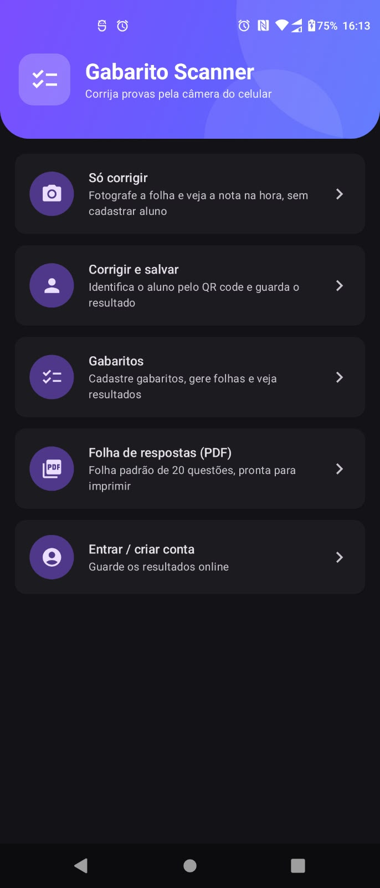
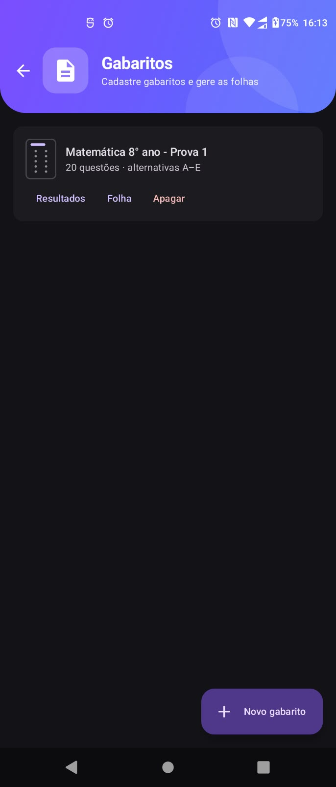
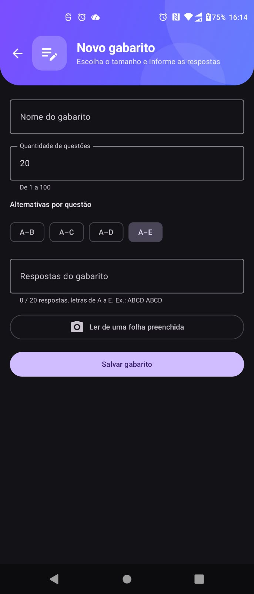
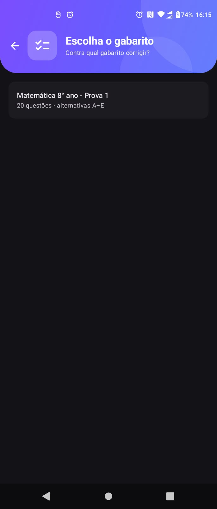
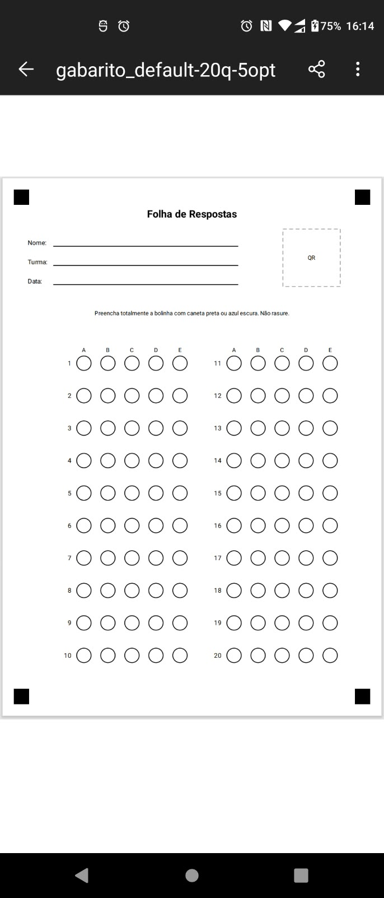
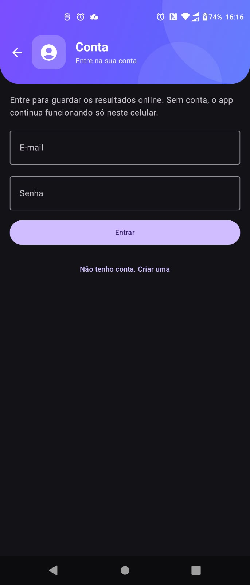

# Gabarito Scanner

Aplicativo Android que **corrige folhas de respostas (gabaritos) pela câmera do celular**: o professor fotografa a folha preenchida, o app lê as marcações, compara com o gabarito oficial e mostra acertos, erros e nota. Os resultados podem ser guardados no celular e sincronizados online.

Projeto de portfólio, feito para uso real por professores da rede municipal (provas bimestrais com 6º ao 9º ano).

> **Dados fictícios.** Este repositório não contém dados reais de alunos. Todos os nomes e matrículas usados em testes e exemplos são inventados (LGPD).

## O que o app faz

- **Cadastro de gabarito** de duas formas:
    - digitando as respostas (o professor escolhe a quantidade de questões, de 1 a 100, e de alternativas, de 2 a 5);
    - **lendo uma folha preenchida** pela câmera, com tela de conferência para corrigir marcações em branco ou duplas.
- **Folha de respostas em PDF** gerada pelo próprio app, de acordo com o gabarito escolhido (colunas ajustadas automaticamente), pronta para imprimir.
- **QR code por aluno**: a folha pode sair com o QR do aluno (matrícula e nome) e o nome já impresso.
- **Dois modos de correção**:
    - **Só corrigir**: lê uma folha, mostra a nota e passa para a próxima, sem cadastrar aluno e sem salvar nada;
    - **Com aluno**: identifica o aluno pelo QR code (ou o professor digita nome e matrícula) e guarda o resultado.
- **Histórico por prova** com média e lista de resultados.
- **Conta e sincronização online**: login por e-mail e senha, envio dos gabaritos e resultados para a nuvem. O app funciona offline, e o envio manda só o que ainda não foi sincronizado.

## Telas

<table>
  <tr>
    <td align="center"><br><sub>Tela inicial</sub></td>
    <td align="center"><br><sub>Tela inicial</sub></td>
    <td align="center"><br><sub>Gabaritos</sub></td>
    <td align="center"><br><sub>Novo gabarito</sub></td>
  </tr>
  <tr>
    <td align="center"><br><sub>Escolha do gabarito</sub></td>
    <td align="center"><br><sub>Folha de respostas (PDF)</sub></td>
    <td align="center"><br><sub>Conta</sub></td>
  </tr>
</table>

> Todas as telas usam dados fictícios.
- 

## Como a leitura funciona

1. **Foto** com CameraX.
2. **Alinhamento**: o OpenCV acha os 4 marcadores pretos dos cantos da folha e corrige a perspectiva (transformação de perspectiva para uma folha plana e padronizada).
3. **Leitura das bolinhas**: para cada alternativa, o app mede o quanto a bolinha está escura em relação ao papel ao redor. A leitura tolera pequenos desvios de posição, sombras e inclinação.
4. **Classificação** de cada questão: marcada, em branco ou marcação dupla.
5. **Correção**: acertos, erros (erradas + em branco + duplas) e nota de 0 a 10.

A geometria da folha fica em um único lugar (`SheetLayout`), usada tanto para **desenhar** a folha quanto para **ler** a foto, então o que é impresso é exatamente o que o leitor procura.

Limitações atuais: a folha precisa ser a gerada pelo app (4 marcadores nos cantos) e fotografada inteira, na posição normal (não girada em 90°/180°).

## Tecnologias

| Área | O que foi usado |
|---|---|
| Linguagem / UI | Kotlin 2.2, Jetpack Compose (Material 3) |
| Arquitetura | MVVM com `AndroidViewModel`, `StateFlow`, navegação por estado |
| Câmera | CameraX 1.6 |
| Visão computacional | OpenCV 4.13 (contornos, perspectiva, limiar adaptativo) |
| Dados locais | Room 2.8 (com KSP) |
| QR code | ZXing (gerar e ler) |
| PDF | `PdfDocument` do Android + `FileProvider` |
| Nuvem | Firebase Authentication e Cloud Firestore (plano gratuito) |
| Build | Android Gradle Plugin 9.2, catálogo de versões (`libs.versions.toml`) |

## Estrutura do código

```
app/src/main/java/com/devdenisviana/gabaritoscanner/
├── domain/      regras puras (perfil e geometria da folha, aluno/QR)
├── scan/        alinhamento, leitura das bolinhas, leitura do QR
├── grading/     gabarito oficial e cálculo da nota
├── render/      desenho da folha e exportação em PDF
├── data/        Room (entidades, DAOs) e sincronização com o Firestore
└── ui/          telas em Compose (câmera, provas, correção, conta)
```

O código de regra (geometria, leitura, correção, QR) é Kotlin puro e testado na JVM, sem precisar de celular.

## Testes

43 testes unitários (JUnit 4) cobrindo geometria da folha, leitura das bolinhas com imagens sintéticas (incluindo deslocamento e marcação fraca), correção, perfil de folha, texto do QR e ida e volta de QR code.

```
./gradlew testDebugUnitTest
```

## Como rodar

1. Clone o repositório e abra no Android Studio.
2. Crie um projeto no [Firebase](https://console.firebase.google.com) (plano gratuito) e registre um app Android com o pacote `com.devdenisviana.gabaritoscanner`.
3. Baixe o `google-services.json` e coloque em `app/` (o arquivo **não** é versionado).
4. No Firebase, ative **Authentication → E-mail/senha** e crie o **Firestore**, com estas regras:

```
rules_version = '2';
service cloud.firestore {
  match /databases/{database}/documents {
    match /teachers/{uid}/{document=**} {
      allow read, write: if request.auth != null && request.auth.uid == uid;
    }
  }
}
```

5. Rode o app em um celular (a correção usa a câmera).

Sem conta, o app funciona normalmente só no celular. A conta é necessária apenas para sincronizar.

## Privacidade

- Cada professor só enxerga os próprios dados na nuvem (regras do Firestore por `uid`).
- O envio é manual e guarda só o necessário: nome, matrícula, respostas e nota.

## Próximos passos

- Perfil de leitura para o modelo de folha pré-impressa da escola.
- Questões anuladas e mais de uma resposta correta.
- Matrícula por bolinhas, como alternativa ao QR code.
- Exportar resultados (CSV).